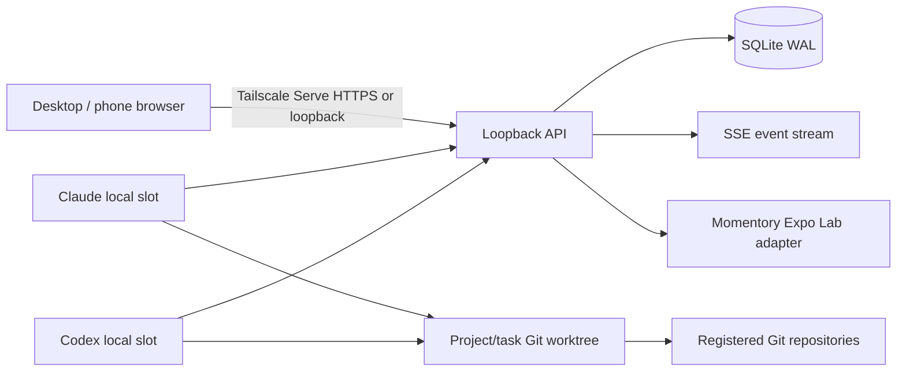

# System Architecture

## Baseline and reuse

On 2026-10-24, `C:\SWM` had no Git root; `C:\SWM\momentory` was a dirty Git `main` that ignored `momentory/`. Momentory FE was a separate dirty `main`; BE was a separate clean `dev`. None of those source changes were reset or discarded. The new workspace is outside those repositories.

| Existing capability | Decision | Integration |
| --- | --- | --- |
| FE Harness Core orchestration, run persistence, bounded retry, protected paths | REUSE / EXTEND | Existing harness remains intact; Workspace reads its FE protected-path policy, while using a general SQLite queue and its own provider adapters. |
| FE parallel Git worktrees | EXTEND | One project-scoped worktree per Workspace task. |
| Expo Web Design Lab, actual RN previews, Studio editor/export/apply validator | REUSE | Momentory-only adapter validates Studio JSON and captures same-viewport A/B images. |
| Playwright, Jest, TypeScript and FE CI | REUSE | Configured repository checks run in isolated worktrees. Native iOS/Android checks remain separate. |
| Multi-project queue, mobile UI, human/AI handoff | NEW | Shared across registered projects. |

Documents in `momentory-integrated-audit/` provide product context. Code took precedence where documentation differed. No app runtime source was changed by the Workspace setup.

## Runtime

`projects.json` defines project IDs, repository paths, checks, protected paths, stacks, and design adapters. Project IDs scope tasks, logs, worktrees, and UI lists. The process is single-user; the same owner token can switch among registered projects. No project-specific path is hardcoded in the queue or provider engine. The Momentory adapter is the only place that knows the Expo Lab format.

SQLite stores tasks, events, workers, decisions, and design candidates. A transactional claim prevents duplicate assignment. Each claim gets a fresh lease nonce; every worker write and heartbeat must present that nonce, so late reports from an old claim are rejected. Each running task has a 30-second lease and a five-second worker heartbeat. Expired tasks with an existing worktree become `STALE` for inspection; they are never silently claimed by another worker. The worker writes a result checkpoint before completion submission. SSE carries changes to connected browsers, with polling as a reconnect fallback.

`FAST` and `SPECIALIST` use one provider. `REVIEW` adds an independent read-only review and bounded correction/review cycle. `EXPLORE` requests independent proposals from both providers and waits for a human design choice. Automatic routing stores its reason. AI task completion requires a changed diff and configured checks; approval is a separate human decision. `HUMAN_TASK` is never claimed by a worker. The dashboard ranks currently executable human tasks and shows blocked dependencies without assuming unfinished AI output.

The launcher has two local provider slots and a maximum of two independent AI tasks. It does not schedule other devices or cloud workers. The laptop must remain awake for execution; internet loss preserves SQLite state but may interrupt provider calls. Windows execution has been exercised; macOS and locked-screen operation need device validation.
